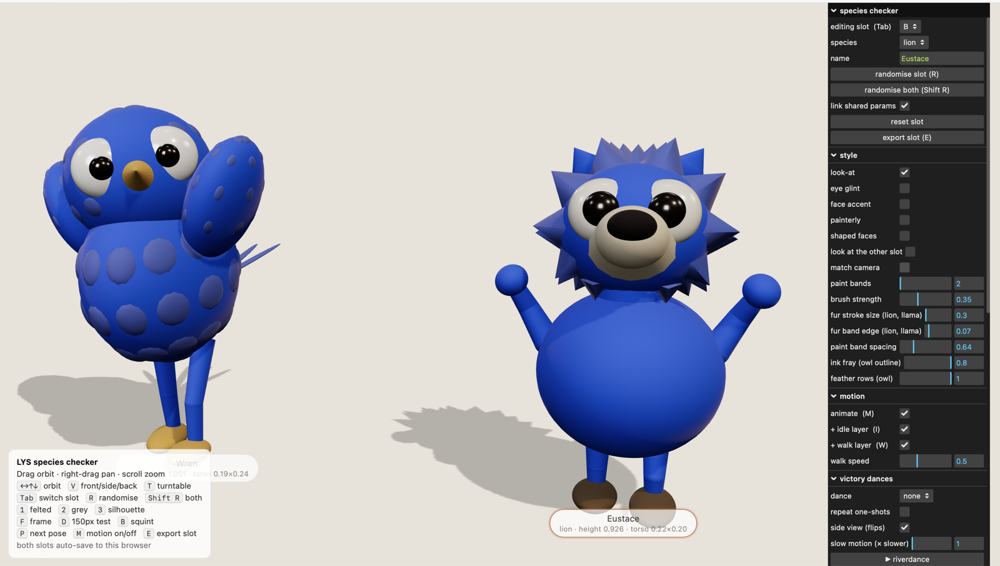
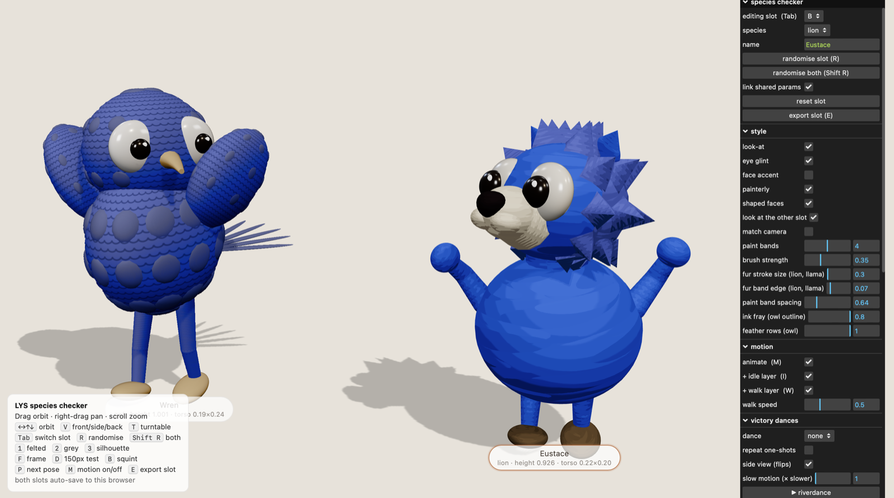

# Character evolution

How the cast has looked, release by release. Newest first. Specs live in BODIES.md; this is the photo album.

## 0.0.8 — 2026-11-05: the art pass

The same two characters (Wren the owl, Eustace the lion) in the species checker, before and after.

| Before | After |
| --- | --- |
|  |  |

**Before:** smooth felt shading, a cone beak, a round lion nose, eyes that stare straight ahead.

**After** (species checker style menu; BODIES.md §Look-at, §Face, §Painterly, §Shaped faces):
- **Painterly.** The lion's fur is broad, flat colour planes after Franz Marc's *Blue Horse I*; the owl is an
  ink wash after Ohara Koson and Bada Shanren, with dark feather rows and a frayed outline.
- **Shaped faces.** The owl's beak curls gently down; the lion has a soft muzzle and a rounded triangle nose.
  Shape only, no line art.
- **Look-at.** Heads turn toward the camera (or the other slot), eyes leading.
- **Eye glint.** A small white highlight in each pupil.

Tried and taken out on the way: an eye ring, then an eyelid-like rim, then an iris; black mouths and whisker
dots; a three-part owl beak. Face accent became **game face paint**, a pick in the fighter chooser (rings,
cheekbone slashes or a cheek heart).
